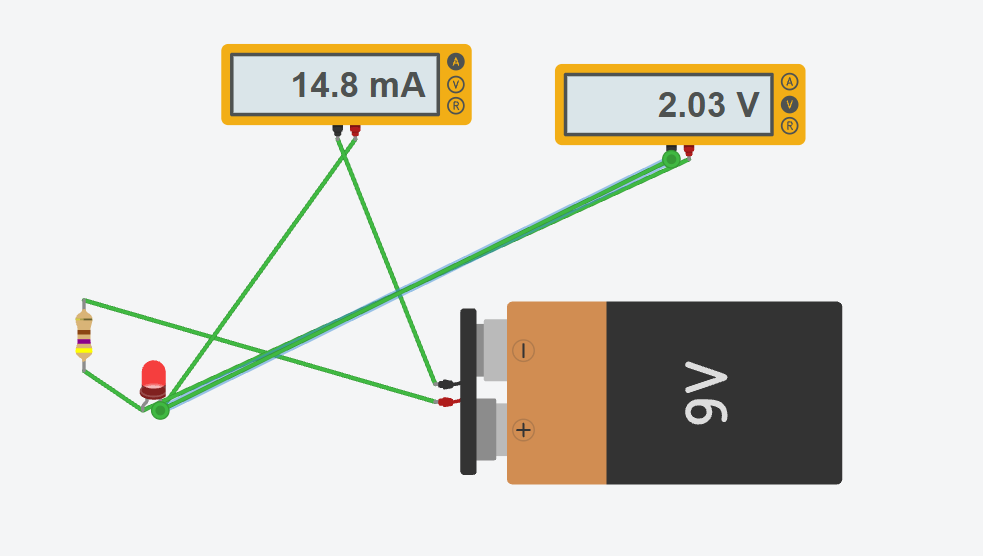
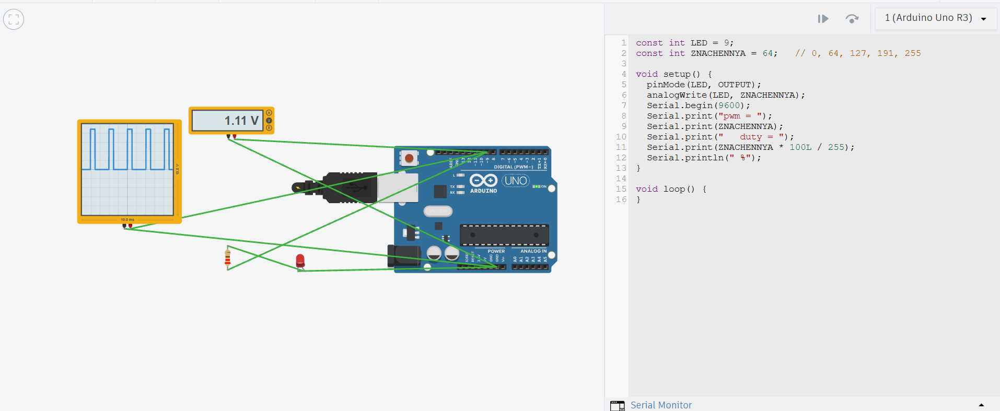
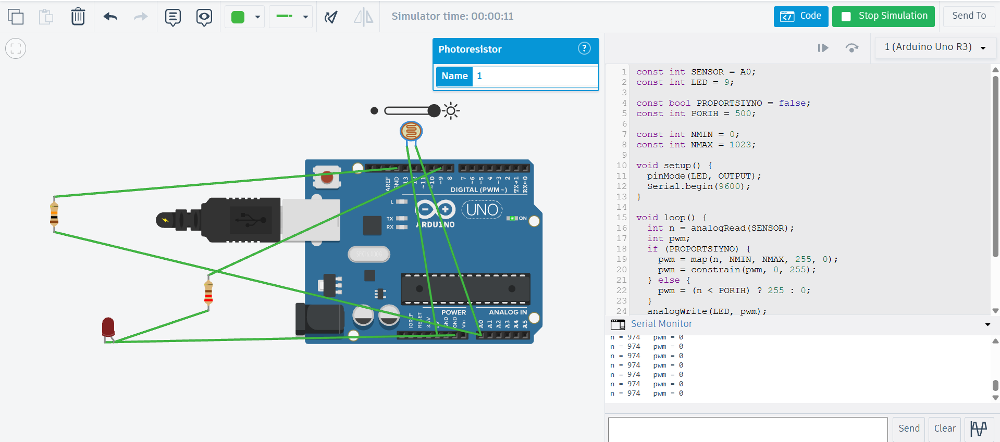

# Робота 10 — що всередині

## 1. Коло й закон Ома
Прогноз: U_LED ≈ 2–3 В · U_R ≈ 6–7 В

| Що | Виміряно |
|---|---|
| U на світлодіоді, В | 2,03 |
| U на резисторі, В | 6,95 |
| I в колі, мА | 14,8 |

R для 5 В і 15 мА = (5 − 2,03) / 0,015 ≈ 198 Ом
Без резистора: струм 915 мА, світлодіод згорів.

## 2. Цифровий пін
Прогноз для ZATRYMKA = 1000: 1–2 з 10
ZATRYMKA = 0: 10 з 10 · ZATRYMKA = 1000: 2 з 10

## 3. АЦП
Прогноз: при 2,5 В n ≈ 512

| Положення | Мультиметр, В | n | U з монітора, В |
|---|---|---|---|
| ліво | 5,00 | 1023 | 5,00 |
| ¼ | 3,40 | 695 | 3,40 |
| ½ | 2,50 | 511 | 2,50 |
| ¾ | 1,70 | 348 | 1,70 |
| право | 0,00 | 0 | 0,00 |

## 4. ШІМ
Прогноз: при 127 мультиметр ≈ 2 В

| analogWrite | Частка «ввімкнено» | Мультиметр, В | Яскравість |
|---|---|---|---|
| 0 | 0 | 0,00 | не світить |
| 64 | ¼ | 1,11 | тьмяно |
| 127 | ½ | 2,20 | середньо |
| 191 | ¾ | 3,32 | яскраво |
| 255 | 1 | 4,44 | яскраво |

## 5. Нічник
Найтемніше n = 54 · найсвітліше n = 974
PORIH = 514 · NMIN = 54 · NMAX = 974
Релейно проти пропорційно — різниця: релейно світлодіод або світить повністю, або гасне (при n = 937 pwm = 0); пропорційно яскравість змінюється плавно (при n = 937 pwm = 11).

 · [sketch.ino](sketch.ino)

## 6. Мій робот у трьох частинах
**Відчути:** ультразвуковий датчик — дає час відлуння, перерахований у см; гіроскоп — кут.
**Вирішити:** автомат станів (patrul → povorot → na_bazu → zaryadka), пороги: стіна 15 см, заряд 30 %, поворот з допуском 3°.
**Діяти:** два мотори, 30 % / 25 % / 20 % потужності; у справжньому роботі це ШІМ на драйвер мотора (L293D).
**Крок:** рядок 98, `time.sleep(0.05)`. Якщо крок 0,5 с — між перевірками робот проїде ≈ 8–9 см і вріжеться в стіну, а на поворотах перекручуватиме.

## Розбір
**Чому вольтметр паралельно, а амперметр у розрив?** Напругу міряють між двома точками, а струм — той, що тече крізь коло. Амперметр паралельно — коротке замикання.

**Чому при analogWrite(9, 127) осцилограф показує 0 і 5 В, а світлодіод світить наполовину?** Пін дуже швидко перемикається між 0 і 5 В, половину часу ввімкнений; око й мультиметр бачать середнє.

**Чому з delay(1000) губляться натискання?** Під час delay програма не читає пін. Для PAUZA в роботі 8: що більша пауза, то пізніше робот реагує.
